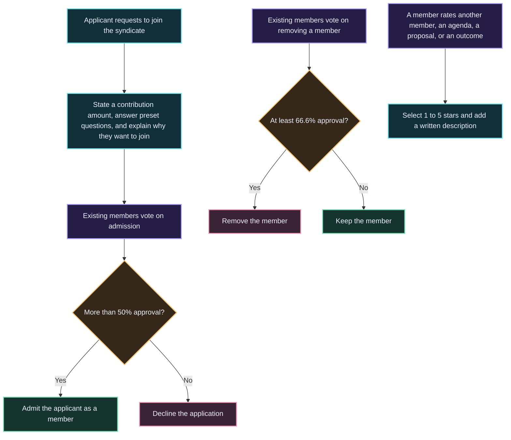
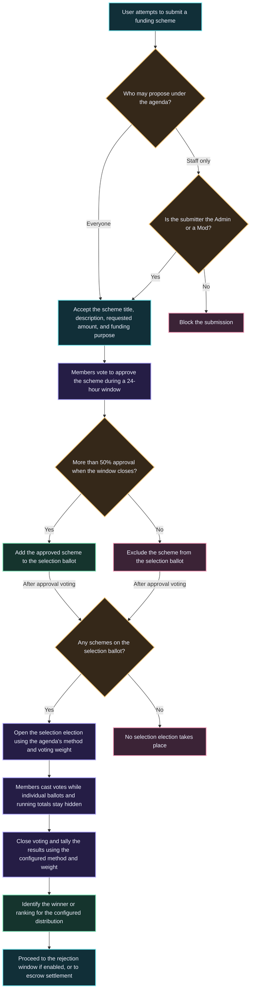
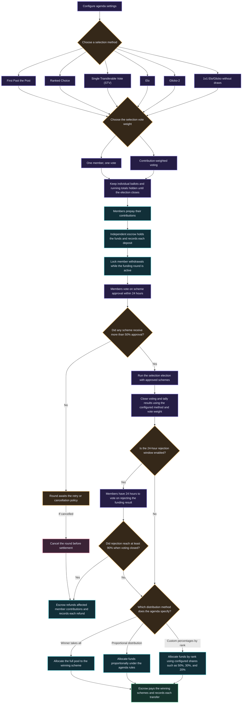
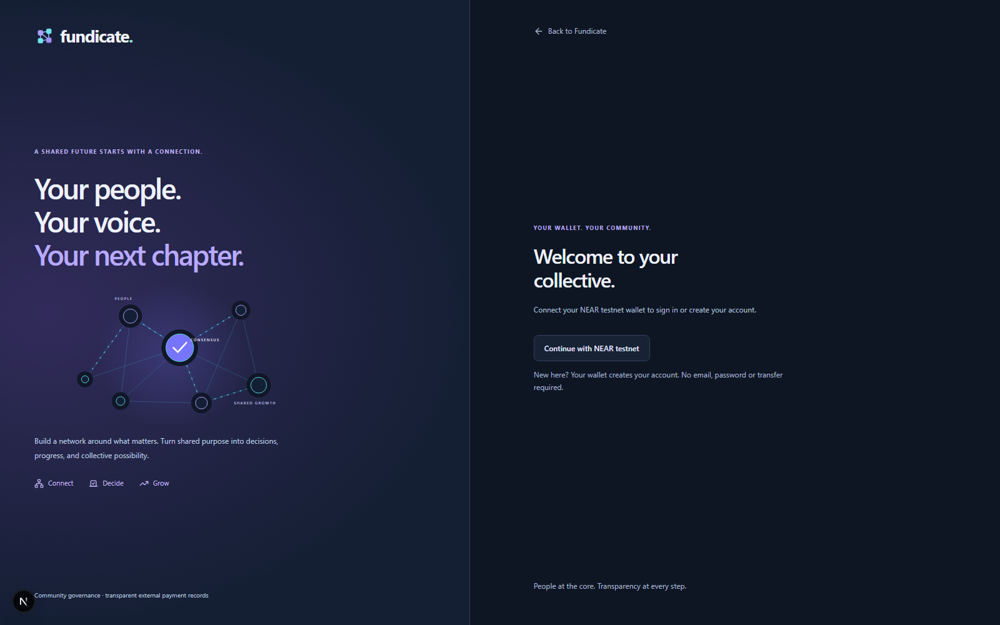

<h1 align="center" style="font-size: 3rem;"><br />Fundicate</h1>

> **Funding + syndication, brought together as Fundicate.**

**Fund together. Decide together.** A community governance app with passwordless NEAR testnet sign-in. Built for [NEAR HACKATHON 2026](https://nearhackathon.com/).

## In a nutshell

### What it does

Fundicate gives clubs, collectives, and community groups a shared record of who can participate, what they are deciding, and how the decision was reached. Organizers publish the rules for a funding round. Members submit and screen proposals, vote on eligible projects, and review the outcome and proposed allocation. Communities can use participation-based reputation, reusable round templates, and analytics to track how they work over time.

**How NEAR fits in.** Fundicate uses NEAR Connect to request a signed ownership message from a testnet wallet. The first verified signature creates an account and later sign-ins return to that account. Users enter no email or password, and signing in sends no transaction. Next.js runs the app, and PostgreSQL stores the governance records and simulated ledgers. A separate Rust treasury contract supports optional testnet settlement.

Staff means the Admin and Mods. The syndicate has one Admin at a time. Mod status gives management permissions and adds no voting weight.

## System flow carts

**work flows**

### Membership and reputation



Applicants state their intended contribution when they apply. Members prepay into escrow during the crowdfunding workflow.

### Scheme approval and selection



### Escrow, rejection, and settlement



Escrow has exclusive custody and settlement authority. Admins and Mods cannot independently access or redirect the funds. Payouts occur after selection voting and any enabled rejection window close. Rejection or cancellation triggers refunds to affected contributors.


### How to run

Use a supported [Node.js version](package.json), npm, PostgreSQL, and a compatible NEAR testnet wallet. From the repository root, install dependencies and start the local database in one terminal.

```sh
npm ci --legacy-peer-deps
npm run db:local -- --keep-alive
```

Keep that terminal open. In a second terminal, apply the schema and start the app.

```sh
npx prisma generate
npm run db:migrate
npm run dev
```

1. Open [the local sign-in page](http://127.0.0.1:3000/login). Choose **Continue with NEAR testnet**, select your testnet account, and approve the ownership message. The **Dashboard** opens after verification.
2. Choose **Create community** and complete the form. The new community opens with your account as administrator.
3. Open **Proposals → New proposal**, choose **Governance change**, and open voting. In a new community with just your wallet, cast **Yes** and select **Finalize decision**. Open **Activity** to see the recorded result.

The local database helper prepares the ignored `.env`. Use `NEAR_WALLET_LOGIN=true` in your environment. For an existing PostgreSQL instance, configure your own `DATABASE_URL` and exact `APP_ORIGIN` there. See [local setup options](docs/guides/getting-started.md#start-a-local-instance) and the [wallet sign-in guide](docs/guides/testnet-wallet-login.md).

### How to deploy

With Docker Engine and Compose v2, run the following from the repository root. It starts PostgreSQL, applies migrations, and serves Fundicate on `127.0.0.1:3000`.

```sh
node scripts/bootstrap.mjs --docker
```

For a public demo, configure an HTTPS origin and reverse proxy using the [wallet demo deployment guide](docs/guides/testnet-wallet-deployment.md). Keep `FUNDICATE_MODE=standalone` and `NEAR_WALLET_LOGIN=true` for wallet onboarding and simulated funding. Deploying the treasury contract is a separate path for [testnet deposits, payouts, and refunds](docs/guides/near-testnet.md).

## Start here for detailed information

| I want to... | then read... |
| --- | --- |
| Watch the walkthrough or see the sign-in screen | [Demo media](docs/media/) |
| Run Fundicate locally and try a complete workflow | [Getting started](docs/guides/getting-started.md) |
| Explore everything members and staff can do | [Documentation home](docs/README.md) |
| Create an account or sign in with a wallet | [NEAR testnet wallet sign-in](docs/guides/testnet-wallet-login.md) |
| Host the wallet sign-in demo | [Wallet demo deployment](docs/guides/testnet-wallet-deployment.md) |
| Deploy, operate or recover a standalone instance | [Deployment and operations](docs/guides/deployment.md) |
| Set up the optional NEAR treasury and verify settlement | [NEAR testnet handoff](docs/guides/near-testnet.md) |
| Understand the application, API and database | [Architecture](docs/reference/architecture.md) · [HTTP API](docs/reference/api.md) · [Data model](docs/reference/data-model.md) |
| Review recorded test passes | [Verification](docs/verification/README.md) |

## Application demo

[](demo-video/brag.mp4)

[Watch the application demo (4:36)](demo-video/brag.mp4) · [View the demo cover](docs/media/fundicate-demo-cover.jpg) · [Browse the screenshots](docs/media/)

The walkthrough follows a collective from setting its rules and admitting members through screening projects, voting, and deciding how to allocate funds. It also explains the rejection window, original-source refunds, transfer records, and payments through the configured NEAR testnet escrow mode.

The [documentation home](docs/README.md) also indexes the delivery plan, the versioned election specifications and the original verification records.

### Open source project

Licensed under the [MIT License](LICENSE).
