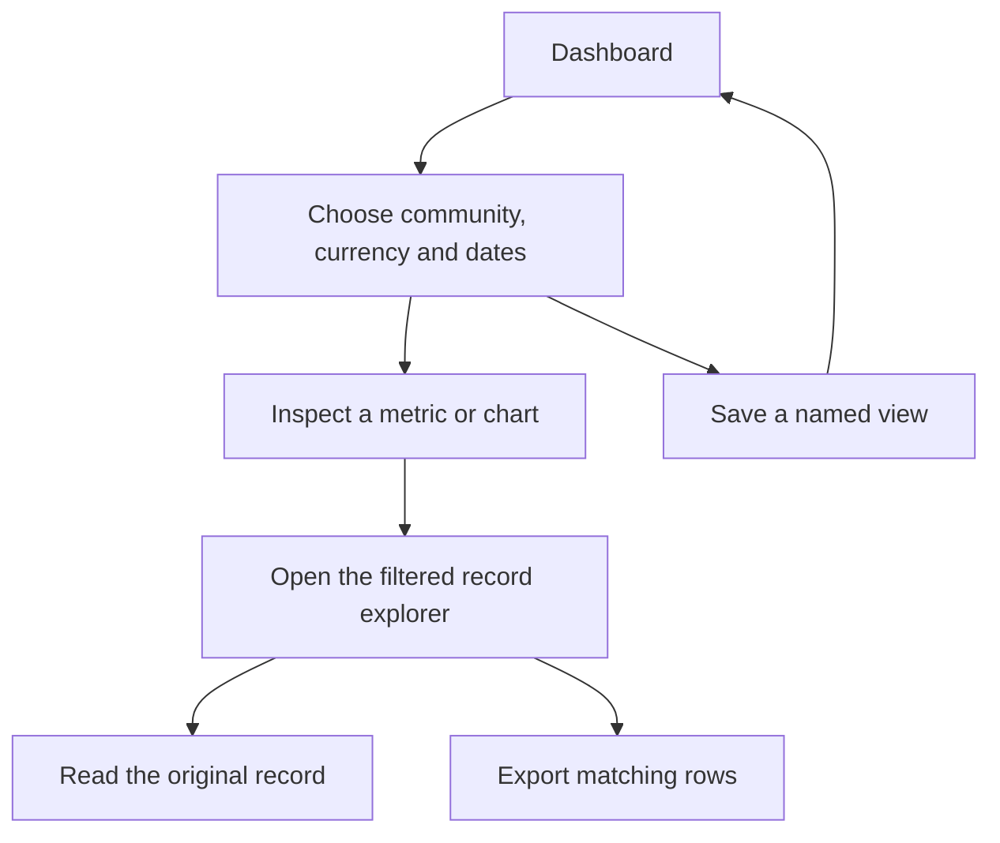

# Analytics and round templates

[Documentation home](../README.md)

## Start with a dashboard, then follow the source

Use **Customize** on the dashboard to choose which of its six sections appear. Fundicate saves that layout for your account. **Analytics** opens a deeper view with community, currency and time filters.

| Report | What to inspect | Drill-down |
| --- | --- | --- |
| Overview | Per-currency funds, participation and activity trends | Open a metric or chart point with its scope |
| Treasury | Opening and closing balances, inflows, outflows, contribution average and median | Inspect transactions and their balanced postings |
| Governance | Proposal pipeline, turnout, approval and ballot choices | Open a decision cohort or a proposal |
| Network & growth | Shared-community links, peers and membership joins | Open the community or filter its join records |
| Your impact | Your contributions, voting opportunities, ballots and activity | Follow your ledger and governance records |
| Record explorer | Transactions, proposals, votes, memberships and audit events | Search and filter, inspect a row or export matching records |

The record explorer shows 25 records per page and supports text, status, type, person and vote-cohort filters as applicable. Export matching records as CSV for analysis outside the app. CSV includes exact minor-unit and display values where applicable, UTC timestamps and source links. Use **Save view** to keep up to 20 named reports. A saved view keeps the filters and uses your current active memberships whenever you reopen it. Layouts and saved views belong to your account.

### Report scope and exports

- Analytics use communities where you hold an active membership. Identity fields are limited to display name, username, avatar and internal ID.
- Record CSV exports include up to 10,000 matching rows. Each loaded dataset can cover up to 50,000 records. Narrow the community or date range for larger reports.
- CSV downloads use private caching rules and per-account rate limits. Text cells escape spreadsheet formulas, quotes and newlines. Transaction rows open an inspector with both ledger entries.

## Read the metrics correctly

| Metric | Definition |
| --- | --- |
| Opening and closing balance | Opening sums treasury postings before the period. Closing adds confirmed movements in the period. The current balance reflects the live account. |
| Inflow and outflow | Positive treasury movements and absolute negative treasury movements in scope. |
| Average and median | In-scope contribution amounts, rounded half up to the nearest minor unit. |
| Turnout | Ballots divided by total frozen eligible-voter slots across proposals created during the period. |
| Approval | Approved outcomes as a share of decided outcomes in the selected proposal cohort. |
| Vote events | The default explorer uses cast time. Decision-cohort mode uses the proposal creation period and lifetime ballots. |
| Peers and community links | A peer is a distinct active co-member. A link means the communities share an active peer. |
| Join trend and personal impact | Joins use membership records within the period. Personal contributions and ballots use your account, and opportunities use frozen electorate entries. |

The 30-day preset starts at UTC midnight 29 days before today and runs through report time. Custom date ranges include both UTC calendar days. Trends use daily buckets through 120 days and monthly buckets for wider ranges. The data below the chart includes exact values and zero-activity buckets.

USD, BDT and EUR each have separate totals. A percentage change needs a nonzero previous-period baseline. Current active members and peers describe the present membership state. The graph shows up to 12 communities while the totals cover the full authorized scope. The source records distinguish transaction, vote, membership and audit counts.

## System insights

Open `/analytics/system` to inspect funded rounds, principal, visible reputation and external payments. Choose an active community and a round creation-date range. The round cohort uses complete in-scope totals and paginated source links.

| Dataset | What its figures represent |
| --- | --- |
| Rounds | Versioned rules, outcomes and published allocation for the round cohort |
| Funds | Received, held, reserved, paid and refunded principal grouped by network, asset, currency and precision |
| Reputation | A current snapshot using the latest visible review in each dimension |
| Payments | A current snapshot of external attestations and reversals grouped by currency |

The round creation period defines the cohort for rules, outcomes and all associated round principal. The complete-cohort report covers up to 500 rounds and shows 25 source records per page. A narrower community or date scope lets you explore a larger collection in slices. Reputation and external-payment snapshots use the current community scope independently of those round dates. Active staff can inspect draft and cancelled rounds for their communities.

The report publishes eligible, participating and quorum power and the allocation after the round is decided and any veto deadline has passed. In-progress ballot counts, choices and rankings stay sealed. The reputation dataset uses latest visible scores. External-payment totals group attestation amounts and reversals by currency.

Round CSV exports the current page. Funds, reputation and payment CSVs export the grouped snapshot. See [GET endpoints](../reference/api.md#get-endpoints) for parameters.

## Reuse round rules

Open **Templates** inside a community. Active members can inspect the library. Administrators and moderators can save rules from an existing round, revise a template, instantiate a chosen revision as a draft or archive the template.

1. Save a named template from a draft or historical round. The revision stores the rule version, submission permissions, quorum, method, seats, power modes, allocation, veto and funding limits as applicable.
2. Instantiate a chosen revision with a future submission deadline. Collection and recovery dates shift using their stored offsets.
3. Review the new draft before opening. Its rule snapshot and exact template revision ID travel with the round.
4. Append another revision when the community wants new defaults. Published rounds continue to reference their own rule snapshot.

The library shows 25 templates per page, with the latest 100 source rounds available in the picker. Staff can supply an older source round by ID through the same community-scoped API. A template copies rules and relative timing. Ballots, schemes, contributions, receipts and results stay in their original round.

The stored collection cutoff is an offset before submission closes, and recovery expiry is an offset after it. Instantiation validates the shifted dates and rule version and saves the draft and its provenance in the same transaction. Staff can use an older numbered revision while the template is active. Archiving preserves revisions and the drafts that reference them. The [template operations](../reference/api.md#funding-rounds-and-templates) describe the version 1 payloads.
