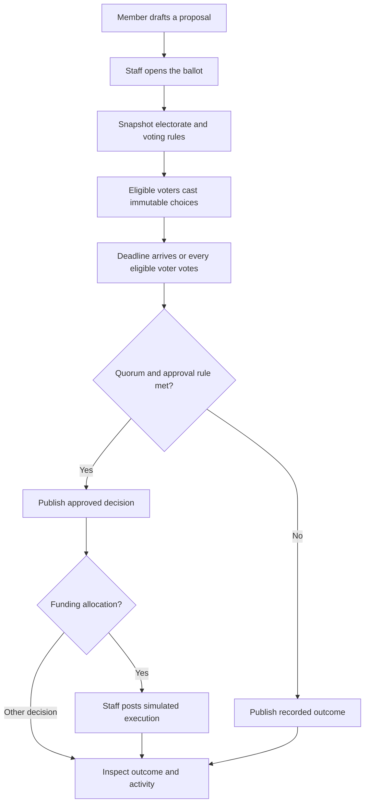

# Community governance

[Documentation home](../README.md)

A community brings together its members, rules, proposals, rounds and treasury. Its administrator starts the community and can appoint moderators. Members use a shared hub to read the rules, apply for roles through the relevant process and inspect recorded decisions.

## Discover, join and manage membership

1. From **Explore**, open a community and read its description, rules and membership questions.
2. Apply with an introduction, answers and a prospective contribution amount. The application preserves your pledge and responses for review.
3. Staff open an admission ballot under the default voting policy. The ballot uses the eligible-member snapshot and the quorum and majority rules recorded at opening. Communities with a preserved direct-review policy follow that policy.
4. Eligible voters cast their votes. Staff finalize when the recorded deadline passes or every eligible voter has voted. Approval activates membership and opens the member workspace.

Staff can use **Members** to inspect pending and decided applications and manage roles. Administrator-only operations include transferring administration and changing moderator assignments. A member can leave. Actions use the community's governance policy, and sensitive role actions ask for a recent password confirmation. Activity records who acted and when.

New communities use the strict governance profile. The founder records an introduction, a prospective declaration and answers to the configured questions. A member records their declaration once, with an audit entry. Returning members keep that original declaration and provide a new application pledge against the current minimum. A member with an older unknown declaration can record it explicitly in Treasury.

| Action | Strict profile | Preserved legacy profile |
| --- | --- | --- |
| Admission | Eligible members decide a ballot | Follow the recorded ballot or staff-review policy |
| Removal | Active members can publish a removal ballot. Administrator removal names an eligible successor. | Follow the existing staff-opened removal ballot process |
| Immediate access review | Use the formal membership and removal process | Staff can record an emergency suspension with a reason and a three-day review ballot. A majority Yes restores access. |
| Administrator succession | A successful succession ballot transfers authority and removes the incumbent in one transaction | Use the administrator transfer action before the incumbent leaves |

The administrator reference requires an active membership. The service preserves that authority during a pending strict succession ballot. Membership and authority history stay available in Activity.

## Run a proposal

Open **Governance** to read the community's admission and voting settings. The proposals workspace covers funding allocations, fundraising targets, governance changes and membership decisions. Member funding submissions begin as drafts under the configured submission policy. Staff can open a draft or open their own proposal at creation. The strict profile provides a member-published removal ballot path.

1. Give the proposal a title and description. Include the recipient and amount for an allocation or the target for fundraising. Choose the threshold, quorum and deadline fields available for the proposal type.
2. Open the ballot. Fundicate stores the eligible voter IDs and decision rule. Voters see the rules and their own ballot status.
3. Eligible members cast one recorded choice of **Yes**, **No** or **Abstain**. Abstentions participate in quorum. The stored policy defines which choices count toward approval and which threshold applies.
4. Finalize to record the result from the frozen electorate. Review the outcome, activity and any execution record from the proposal page.
5. For approved allocations, execute separately as staff. The simulation posts matched ledger entries and supplies a replay-safe receipt.

Quorum is the electorate size times its stored quorum basis points, rounded up to a whole voter. Yes, No and Abstain count toward participation. The approval calculation uses Yes and No. A simple majority needs more Yes than No, and removal uses exact two-thirds support among Yes and No plus quorum. Admission and removal subjects are outside their own electorate. Newly admitted members join future ballots. Valid recorded ballots stay attached to the decision through membership changes. An approved governance change supplies the rules for future decisions.

The single-proposal ballot and the multi-scheme funding round serve different workflows. A [funding round](funding-and-elections.md) compares several competing schemes in timed stages. The [analytics guide](analytics-and-templates.md) explains how decision totals link back to proposals and ballots.
