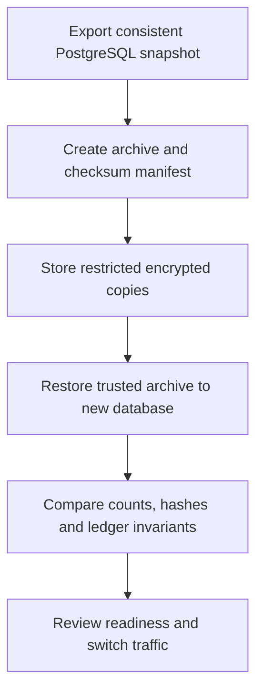

# Deployment and operations

[Documentation home](../README.md)

Fundicate runs as a native standalone Node.js service or as a Docker Compose stack. Both use PostgreSQL for accounts, governance, financial simulations and audit history. For a first local run, follow [getting started](getting-started.md).

## Native service

Provision a dedicated PostgreSQL database and inject configuration from your secret manager or a restricted environment file. Apply migrations with the operator connection. Run the application with a dedicated runtime role. Use the supported Node.js version from [package.json](../../package.json).

```powershell
npm ci --legacy-peer-deps
npx prisma generate
npm run db:migrate
npm run doctor
npm run build
```

For a repository-based start use `npm start`. At runtime, set `DATABASE_URL` to the runtime connection. For the generated package, provide the packaged static assets and launch `.next/standalone/server.js` with the externally supplied environment. The build removes copied environment files from the standalone output. Supply the runtime environment separately. For example, use `node --env-file=/private/path/fundicate.env .next/standalone/server.js` with a restricted environment file and your deployment's host and port settings.

## Docker Compose

Run `node scripts/bootstrap.mjs --docker` from the repository root for the loopback stack. The helper creates a private `.local/deploy/compose.env`, starts PostgreSQL on the internal network, applies migrations with a one-shot tools service and brings up the unprivileged web service on `127.0.0.1:3000`. Subsequent runs reuse the named database volume and existing credentials.

For a public HTTPS origin, prepare the environment first.

```powershell
node scripts/bootstrap.mjs --docker --origin https://your-domain.example --prepare-only
```

Configure the HTTPS reverse proxy to overwrite the selected trusted client-IP header, preserve the browser's Origin header and route traffic privately to the app. Allow the 250,000-byte request limit used by pairwise ballots. Set `TRUSTED_CLIENT_IP_HEADER=x-real-ip` in the generated environment, or use `cf-connecting-ip` with the corresponding trusted Cloudflare configuration. Run the bootstrap again without `--prepare-only`.

| Setting | Purpose |
| --- | --- |
| `APP_ORIGIN` | Exact public HTTPS origin used by requests and session cookies |
| `FUNDICATE_MODE=standalone` | Selects the standalone service |
| `NODE_ENV=production`, `ALLOW_DEMO_SEED=false` | Select production behavior and regular onboarding |
| `DATABASE_URL`, `POSTGRES_PASSWORD` | Operator connection and provisioning secrets |
| `RUNTIME_DATABASE_URL` | Least-privilege connection for Compose web and maintenance |
| `TRUSTED_CLIENT_IP_HEADER` | Client identity supplied by the configured trusted proxy |
| `MAINTENANCE_ACTOR_ID` | Active staff account for the optional maintenance invocation |

The Compose runtime role has data privileges and read-only migration metadata. The tools service uses separate operator credentials. Use verified TLS for external PostgreSQL. The Compose database uses private internal transport and preserves the named volume during repeated bootstrap and compatible upgrades. The bootstrap pins the database image recipe through [Dockerfile.database](../../Dockerfile.database).

## Readiness and maintenance

Run `node scripts/doctor.mjs --deployment` to check configuration, database connectivity and migration state. Probe `GET /api/health` for a readiness response. Register through the normal flow and create a community to confirm the application workflow. The runtime can emit request IDs for correlation with its safe structured diagnostics.

```powershell
node scripts/maintenance.mjs --actor STAFF_USER_UUID --dry-run --once
node scripts/maintenance.mjs --actor STAFF_USER_UUID --apply --once --limit 100
```

Maintenance checks each actor's community authority and advances due published proposals, round stages, veto windows and settlement work. It uses the same versioned rules, deadlines and settlement checks as the interactive path. An operator can invoke it from a scheduler or through the optional Compose profile. For Compose, set `MAINTENANCE_ACTOR_ID` and run the profile explicitly.

```powershell
docker compose --env-file .local/deploy/compose.env --profile maintenance run --rm maintenance node scripts/maintenance.mjs --apply --once
```

Monitor readiness and request IDs, maintenance outcomes and accounting checks in the target environment.

## Backup and recovery



Run `node scripts/backup.mjs` to capture a custom-format PostgreSQL archive and a manifest with its SHA-256, table content hashes and accounting checks. Restrict access to both files. The restore helper checks the archive and restores to a new database using a transaction.

```powershell
node scripts/restore.mjs --input PATH_TO_DUMP --database fundicate_restore_TIMESTAMP_PID --trusted-backup
npm run test:recovery
```

The isolated exercise uses the real PostgreSQL export and restore tools, then compares a recorded snapshot against the restored copy. Plan a deployment cutover after checking readiness, reconciling accounting and confirming operators can access the intended data. Use compatible PostgreSQL client tools and set `PG_BIN` when the tools are outside PATH. Store the archive and manifest with restricted access and encrypted copies. Restore a trusted archive into a fresh database matching the required `fundicate_restore_TIMESTAMP_PID` name. The helper compares table counts, content hashes and accounting checks. Confirm the target and stop application writers for the cutover. Reconcile the external-payment register with source records and retain the environment, source version and deployment artifacts separately. Set recovery objectives and arrange the backup frequency and retention your deployment needs.
