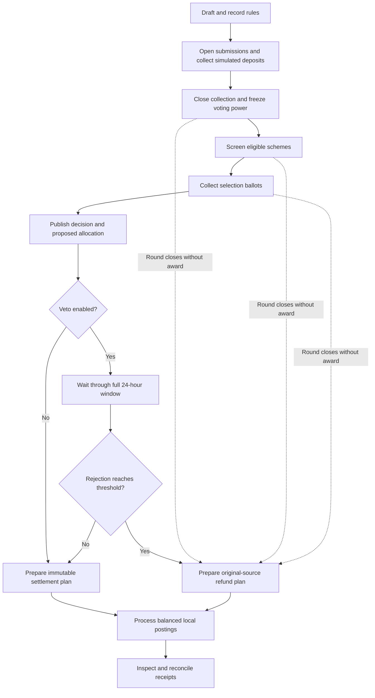

# Funding and elections

[Documentation home](../README.md)

Use **Funding rounds** when a community wants to gather schemes, screen them, compare the qualified options and optionally allocate a separate simulated pool. Staff configure and open rounds. Eligible members submit schemes and vote. The round page brings the published rules, deadlines, schemes, result and receipts together.

## Create and run a round

| Stage | Who acts and what Fundicate records |
| --- | --- |
| Draft | Staff choose the agenda, submission deadline, quorum and funding rules. A draft can come from a specific template revision. |
| Submissions | Eligible members submit a scheme with its title, explanation, requested amount and recipient details as applicable. Funded rounds record simulated deposits through their collection cutoff. |
| Screening | Eligible voters cast Yes, No or Abstain per scheme. After the 24-hour stage, participation is compared with the stored quorum and Yes power must exceed No power for qualification. |
| Selection | Eligible voters use the published ballot format over qualified schemes. After the 24-hour stage, the selected method calculates a result and stores the supported allocation. |
| Rejection veto | When enabled, the published allocation waits through a full 24-hour window. A voter can record Reject, Keep or Abstain using the frozen veto power. |
| Settlement | Staff or authorized maintenance prepare and process the immutable local settlement plan. The round shows payouts, original-source refunds and execution receipts. |

Voters can see their own in-progress round ballots. Publication reveals the completed stage according to its stored visibility rules. System reports apply the complete-context privacy boundary through an enabled veto window. See the [architecture reference](../reference/architecture.md) for the data path.

The organizer can set the submission policy to staff, members or everyone. A funded scheme can identify its request as a donation, crowdfunding or investment request and give a recipient label and supporting link. A funded round also sets its target, minimum first deposit, cumulative per-contributor maximum, collection cutoff and recovery expiry. Deposits and top-ups record the actual simulated receipt amount and its owner. The original contributor retains their refund claim through membership changes.



This flow describes funded rounds with frozen voting power. Decision-only rounds record the result and its supporting ballots.

## Versions and voting power

| Version | Preserved rules |
| --- | --- |
| V1 | Decision-only multi-scheme rounds |
| V2 | Local simulated funding with equal-weight first-past-the-post and winner-all allocation |
| V3 | Independent screening, selection and veto power modes, three allocations and optional rejection veto |
| V4 | Six selection methods with equal or contribution-based selection power and all three allocations |

For funded V3 and V4, membership changes up to the collection cutoff feed the electorate. At the cutoff, each eligible member has equal power of one and paid power equal to their received simulated round contributions in minor units. The round chooses independently which mode each stage uses. Only positive stage power can cast that stage's ballot. Quorum rounds up from total eligible stage power multiplied by the quorum basis points. Application pledges and prospective declarations remain separate records.

## Selection methods

| Method | What the voter submits | How the result is calculated |
| --- | --- | --- |
| First-past-the-post (FPTP) | One scheme | Sum choice power per scheme and order by support |
| Instant-runoff voting (IRV) | Ordered preferences | Eliminate according to the published rule and transfer ballots to continuing choices |
| Single transferable vote (STV) | Ordered preferences | Allocate a configured number of seats with the recorded quota, surplus transfers and eliminations |
| Elo | Pairwise comparison sheet | Update ratings in one simultaneous batch using each scheme's pre-period rating |
| Glicko-2 | Pairwise comparison sheet | Update rating, rating deviation and volatility for one rating period |
| Forced-choice pairwise | A choice for every required pair | Aggregate the pair results and rank by the published pairwise scoring rule |

Pairwise methods publish complete comparison rules. Contribution-weighted Elo and Glicko-2 use the documented paid-frequency extensions. Financial support uses the method-specific support values in the frozen specification. Read the [V4 contract](../algorithms/part-04.md) or open `/rules/fundicate-methods-v1` in the app for ballot fields, tie treatment, full formulas, transcripts and the complete 36-combination matrix.

## Allocation and receipts

**Winner-all** pays the supported unique leader up to the scheme request. **Proportional** divides the pool by positive support, with deterministic largest-remainder rounding. **Ranked cuts** assign published basis-point shares to rank slots. Request caps and recipient checks determine what can be paid. Unused shares return to original contribution sources. The published rules describe ties and missed quorum outcomes for each method and allocation.

An enabled veto reaches rejection when Reject power is at least 90% of total eligible veto power. The denominator includes abstentions and members who leave the window without casting a ballot. Rejection settles as original-source refunds.

Fundicate records the local pool in exact integer minor units, with a separate ledger from the community treasury. Preparation reserves the plan. Processing uses the same operation identities on retry and posts matched debit and credit entries. Reconciliation checks the atomic ledger for the operation identity and intent before a retry. The round detail shows the decision, payout and refund amounts, plan operations and your authorized receipt details.

```text
received principal = held + reserved + paid + refunded
```

See the [V3 contract](../algorithms/part-03.md) for cutoff, eligibility, rounding and settlement invariants. See [payments and reputation](payments-and-reputation.md) for the external attestation register.
