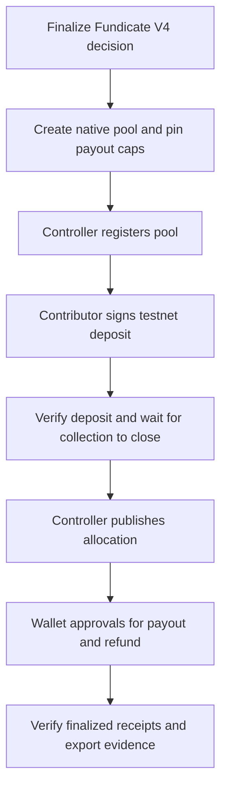

# NEAR testnet hackathon handoff

[Documentation home](../README.md) · [Treasury contract interface](../NEAR-CONTRACT.md) · [Wallet sign-in](testnet-wallet-login.md)

Fundicate has an opt-in testnet treasury. The application reuses an unrejected, finalized V4 decision and its published election support and allocation policy. The treasury collects native testnet NEAR in a separate pool with its own payout caps, recipients and receipts. The controller wallet attests the Fundicate decision, and the contract enforces the committed plan and original-source refunds. For the hackathon’s sign-in and governance demo alone, follow [wallet demo deployment](testnet-wallet-deployment.md).

## 1. Prepare the testnet accounts

Use a funded `.testnet` treasury account for deployment and a wallet account that will act as the controller. Also choose a testnet payout recipient. One controller wallet can also act as the demo contributor. Keep the treasury deploy key in your NEAR CLI keychain and approve runtime transactions in your wallet. Fundicate needs public account IDs and a WASM hash.

The treasury account needs testnet NEAR for WASM storage, state growth and its operating buffer. The controller and contributor wallets need their own gas balances. The readiness check in step 2 reports whether the initialized contract has sufficient operating reserve.

```powershell
npm ci --legacy-peer-deps
npm run near:contract
npm run --silent near:check -- --code-hash
```

The contract command formats-checks the pinned Rust source, runs its tests and builds the deployment artifact. It needs Rust and the `wasm32-unknown-unknown` target. The last command prints the base58 code hash of that artifact.

Use [NEAR CLI](https://docs.near.org/tools/cli) and its OS keychain to deploy and initialize together. Replace the two example account IDs with yours.

```powershell
$treasury = 'your-treasury.testnet'
$controller = 'your-controller.testnet'
$wasm = 'contracts/near-treasury/target/wasm32-unknown-unknown/release/fundicate_near_treasury.wasm'
$init = @{ controller = $controller; network = 'testnet' } | ConvertTo-Json -Compress
near contract deploy $treasury use-file $wasm with-init-call new json-args $init prepaid-gas '100 Tgas' attached-deposit '0 NEAR' network-config testnet sign-with-keychain send
```

## 2. Connect Fundicate

Use the local setup from [Getting started](getting-started.md). Set these values in your ignored runtime environment file. Replace the existing mode line with the testnet value.

```dotenv
FUNDICATE_MODE="near-testnet"
NEAR_WALLET_LOGIN="true"
NEAR_CONTRACT_ID="your-treasury.testnet"
NEAR_CONTRACT_CODE_HASH="<base58 code hash from near:check -- --code-hash>"
NEAR_RPC_URL="https://test.rpc.fastnear.com"
```

```powershell
npm run near:check
npm run dev
```

`near:check` reads the configured RPC and verifies its chain ID, the account's deployed code hash, initialized asset, controller and reserve status. Use a testnet RPC provider with access to finalized transaction receipts. The app's default mode is `standalone`. For Compose, put the same testnet variables in the private `.local/deploy/compose.env` used by [bootstrap](deployment.md#docker-compose) and recreate the web service through that command.

Sign in using the controller wallet. Fundicate verifies its signed ownership message against a full-access key on testnet. Choose a [NEAR Connect wallet](https://docs.near.org/tools/near-connect) that supports both message signing and transaction approvals on testnet.

## 3. Complete the live demo

As a community administrator or moderator, open **NEAR testnet** once your community has an unrejected, finalized V4 decision with an approved allocation. The walkthrough below assumes a unique winner and the **Winner-all** policy. See [funding rounds and elections](funding-and-elections.md) to prepare the decision.

1. Confirm your identity in **Settings → Security** with a fresh wallet signature, then create a native pool from the finalized decision. Give the winning scheme a cap of **0.1 NEAR**. Enter a valid testnet recipient and positive cap for each qualified scheme. Set a collection window long enough to register and deposit.
2. Choose **Register pool on NEAR** and approve in the controller wallet. If readiness reports `reserve-needed`, use the pool's reserve top-up action before depositing.
3. Deposit **0.2 NEAR** using a linked testnet wallet and verify its receipt in Fundicate. Keep the demo deposits in Fundicate so each source can be reconciled against the contract before publication.
4. At the collection cutoff, refresh the page. Use **Publish allocation** and approve with the controller wallet. The demo's winner-all policy produces a **0.1 NEAR payout** and a **0.1 NEAR refund** to the original depositor.
5. Approve the payout and refund from the immutable allocation. Confirm that both receipts show `CONFIRMED`. For a wallet return with only a hash, paste that hash into the matching operation's **Verify receipt** form. If a wallet approval is interrupted, check wallet history for the original hash and reconcile that operation before another signing attempt.



## 4. Export the evidence

Select the pool in the treasury workspace. Copy the UUID in the `pool` query parameter, then run the command against the same database and runtime configuration.

```powershell
npm run --silent near:evidence -- --pool '<pool UUID>' | Tee-Object -FilePath near-testnet-evidence.json
```

The read-only verifier independently queries [NEAR transaction finality](https://docs.near.org/api/rpc/transactions), matches the signed action and transfer receipt, checks the contract's operation result, and reconciles the round's full deposit, payout and refund amounts in yoctoNEAR. Save the JSON and transaction links for the hackathon handoff. This guide is complete when your demo has that verified output.

## Run the local integration check

The original treasury handoff ran `npm run test:near` against a disposable database and a mocked NEAR RPC. That build passed 202 application unit tests, 35 contract tests, the isolated NEAR integration check, 61 standalone HTTP checks, 12 application security groups and 9 operations security tests. The WASM build and packaged secret scan also passed on that snapshot. For the current wallet sign-in check, see [wallet demo deployment](testnet-wallet-deployment.md#verify-the-integration-locally).
