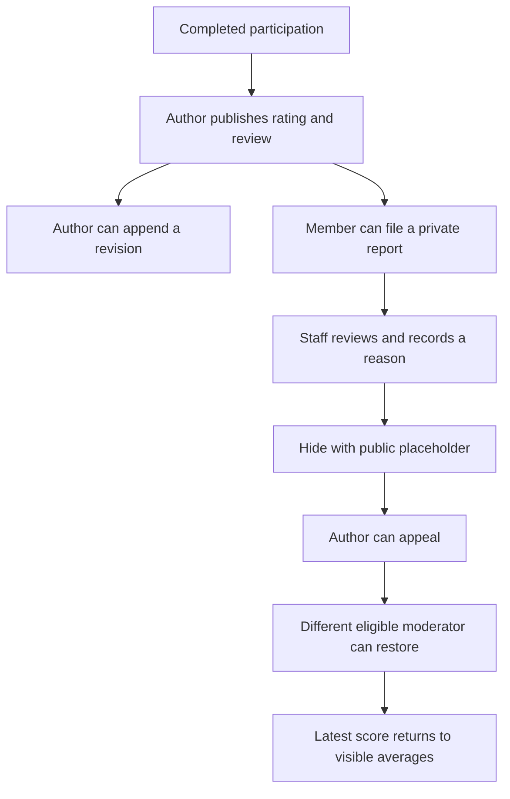

# Payments and reputation

[Documentation home](../README.md)

Fundicate gives members a traceable financial history and participation-based feedback. Choose the record that matches the activity you want to document.

## Financial records

| Record | Where to find it | How it works |
| --- | --- | --- |
| Pledge or contribution declaration | Application or Treasury | Stores an amount the member intends to contribute |
| Community treasury contribution | Treasury | Posts an exact simulated amount into the community treasury using matched ledger entries |
| Proposal execution | Proposal and Treasury | Posts a separate simulated allocation after approval and preserves its execution receipt |
| Round contribution or settlement | Funding round detail | Tracks simulated received principal, held and reserved balances, payouts and original-source refunds in a separate ledger |
| External-payment attestation | Payments | Stores a staff record of a contribution, payout or refund made through an external channel, with source and correction history |

The treasury fixes the community currency. Contributions debit the simulated external contra account and credit the treasury. Executed allocations debit the treasury and credit the paid account. Each transfer has two signed entries that sum to zero, and account balances reconcile to the sum of their entries. Execution checks the live available balance, and replay keys keep a matching retry attached to the original receipt. Approved fundraising goals track lifetime simulated community contributions.

### Use the external-payment register

Open **Payments** for the community. Active members can browse its scoped register and export it. An active administrator or moderator confirms their password, then records the payment type, amount, currency, payment date and available reference details. Link the counterparty and funding round when applicable. The register labels each entry as a staff attestation with independent verification status, while the treasury and round ledgers continue to show their simulated balances.

Use the reversal action to correct an entry. It appends a full-source reversal tied to the original attestation. For a replacement, enter a new attestation with the corrected information. Currency totals use originals and linked reversals. Preserve external evidence in its source system for reconciliation.

## Write a review

Open **Reputation**, choose an eligible target and write a 20–3,000 character review with a whole-star score from 1 to 5. Targets include members, funding schemes, legacy proposals and funding rounds. The composer uses completed contexts that contain recorded participation. A shared context can come from authoring, voting or an applicable received round contribution.

| Dimension | Applies to |
| --- | --- |
| Participation | Members and rounds |
| Presentation | Schemes and proposals |
| Receipt-backed recipient experience | A matching confirmed payout or approved funding execution with its recorded ledger receipt |

The receipt-backed dimension describes payment evidence, including simulated receipts. A matching confirmed round payout can qualify a member or scheme. A confirmed funding execution and ledger transaction can qualify a proposal. The stored dimension is `VERIFIED_RECIPIENT_PERFORMANCE`.

### Eligibility and visible averages

- Active members write reviews about someone else's participation or work. A member review requires both people to have participated in the same completed context. A scheme or proposal uses its own round or proposal context.
- A round qualifies once it has a recorded decision and any veto window has elapsed. Round creation, scheme authorship, an actual recorded ballot or a received deposit can establish participation. Finalized proposals use proposal authorship or recorded votes.
- The composer offers eligible choices from the latest 30 completed rounds and 30 finalized proposals. Older eligible contexts are available through the [API](../reference/api.md#reputation-and-payments). The list shows the latest 50 review bodies.
- Each author can review a given target and dimension once per community. Creation stores an initial revision. Editing checks eligibility and appends a numbered score and text revision for the same target and context.
- Averages use the latest score from every currently visible review in each target and dimension, including reviews beyond the list.

## Report, moderate and appeal

An active member can submit a private report about another author's review. Unconflicted staff can hide or restore a review with a public reason. A hidden review has a public placeholder and retained revision history that authors and staff can inspect. The author can appeal the current hide event. A different unconflicted moderator can review an appealed hide and restore visibility.

A member can file one private report per review by another author. Staff can moderate a review when they are outside its author, target and ownership relationships. The author can submit one appeal per current hide event. The recorded appeal and hide stay in effect until a different unconflicted moderator restores the review.

A hidden review's public placeholder shows the author, target, revision number and moderation reason. Authors and staff can inspect preserved revision and appeal history, and staff can inspect private reports. Visibility follows the ordered moderation events. Editing adds a revision to that history. Audit records identify the review action and subject.

[System insights](analytics-and-templates.md#system-insights) groups current visible reputation and external payments into their own reports.
