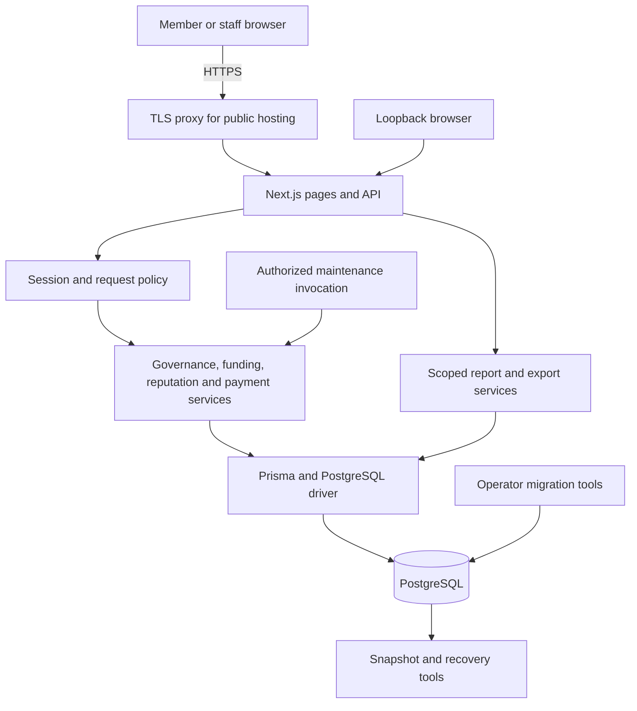
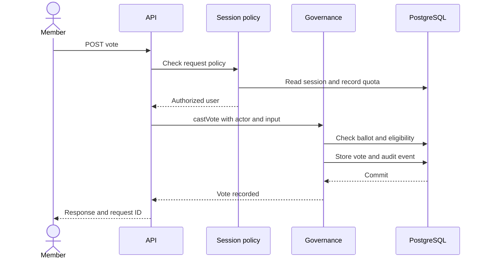
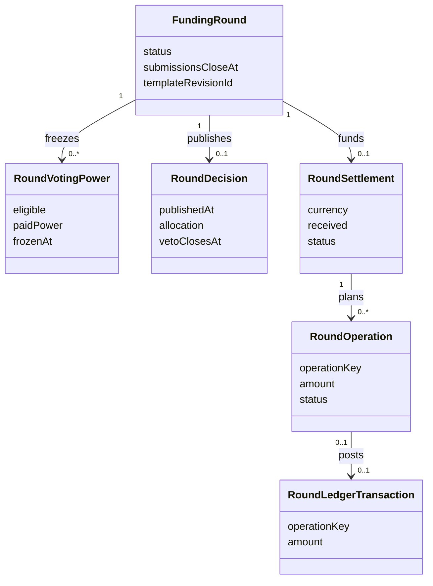

# Architecture

[Documentation home](../README.md)

Fundicate is a standalone Node.js application. Next.js serves the public pages, authenticated community workspaces, reports and HTTP handlers. Prisma and the PostgreSQL driver connect domain services to a shared database. The database owns durable session, ballot, audit and ledger state.

## Code map

| Layer | Source | Responsibility |
| --- | --- | --- |
| Pages | [src/app](../../src/app) | Render public pages, settings, community hubs and private reports |
| UI | [src/components](../../src/components) | Forms, navigation, dashboards, record views and charts |
| Mutation gateway | [API route](../../src/app/api/%5Boperation%5D/route.ts) | Validate request origin, body, session, rate policies and recent authentication |
| Identity and request controls | [auth.ts](../../src/lib/auth.ts) · [session-security.ts](../../src/lib/session-security.ts) · [http-security.ts](../../src/lib/http-security.ts) | Salted scrypt passwords, hashed session tokens, reauthentication and persisted request quotas |
| Governance | [service.ts](../../src/lib/service.ts) · [governance.ts](../../src/lib/governance.ts) · [treasury-adapter.ts](../../src/lib/treasury-adapter.ts) | Create communities, manage membership, calculate decisions and post simulated treasury entries |
| Funding lifecycle | [rounds.ts](../../src/lib/rounds.ts) · [rounds-v3.ts](../../src/lib/rounds-v3.ts) · [funded-rounds.ts](../../src/lib/funded-rounds.ts) | Publish versioned rounds, collect votes, freeze power, calculate decisions and reconcile operations |
| Method logic | [rounds-core.ts](../../src/lib/rounds-core.ts) · [elections-core.ts](../../src/lib/elections-core.ts) · [methods-core.ts](../../src/lib/methods-core.ts) | Validate round settings and compute tallies, method transcripts and allocations |
| Reviews and payments | [reputation.ts](../../src/lib/reputation.ts) · [payment-records.ts](../../src/lib/payment-records.ts) | Check recorded context and write revisions, moderation events or scoped attestations |
| Analytics and templates | [analytics.ts](../../src/lib/analytics.ts) · [release-analytics.ts](../../src/lib/release-analytics.ts) · [round-templates.ts](../../src/lib/round-templates.ts) | Scope reports to memberships, project display-safe data and retain exact template revisions |
| Persistence | [Prisma schema](../../prisma/schema.prisma) · [migrations](../../prisma/migrations) | Model relationships, constraints, indexes and database invariants |
| Operations | [scripts](../../scripts) · [compose.yaml](../../compose.yaml) | Package, migrate, check readiness, run scheduled work and exercise recovery |

## UML sequence for a proposal ballot

A browser or in-process operator starts with a known actor. Service checks use the current community and action. Write transactions preserve the record relationships that make a result reproducible. Proposal votes reference an eligible-voter snapshot. Funded-round decisions reference frozen voting power and publish the selection result and proposed allocation.

## UML class view of the funding record

The diagram shows persisted domain types. Next.js and the domain modules work with these records as typed data.

## Data visibility and exact money

- **Accounts and roles.** An opaque session cookie identifies an account through its stored token hash. Role and membership checks run on scoped service requests. Sensitive authority and payment operations require a recent password confirmation.
- **Round privacy.** Server services select a visibility-safe view before pages or CSVs receive records. A voter sees their own pending ballot. Published outputs use the method and veto visibility rules.
- **Money.** The simulated treasury and funded-round accounts use exact integer minor units. A round operation posts paired ledger entries inside the transaction. Staff-recorded external payments use a separate append-only register with linked reversals.
- **Traceability.** Activity points to decisions and operations. Templates retain immutable revisions, rounds retain immutable decisions and settlement plans, and reviews retain revision and moderation history.
- **Runtime and maintenance.** A runtime role accesses the application tables. Operators apply migrations using a separate identity. Maintenance calls the same service rules as an interactive request.

The [data model](data-model.md) shows physical relationships, and the [HTTP API](api.md) documents supported entry points.
