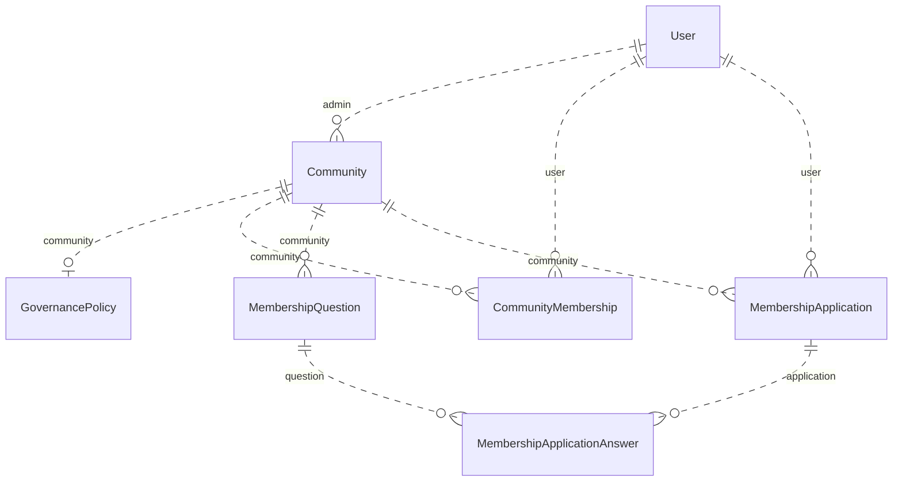
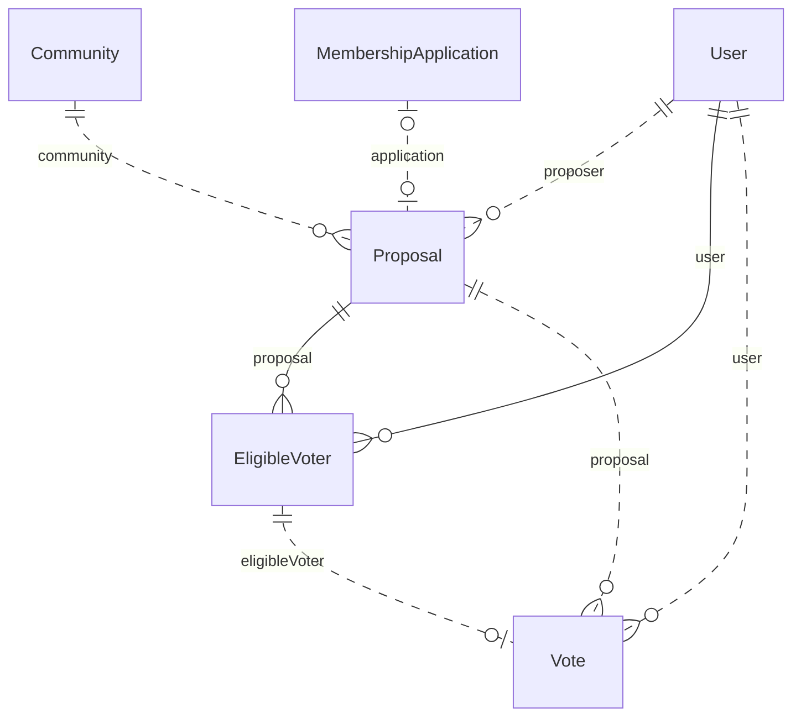
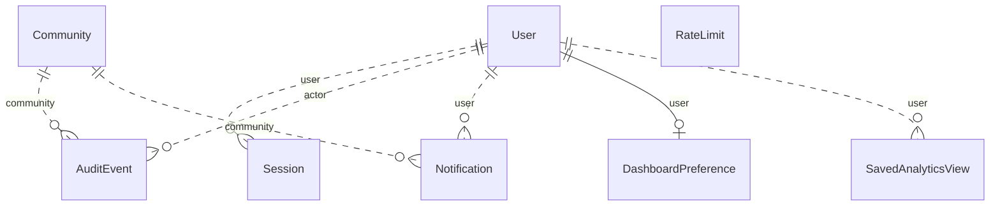
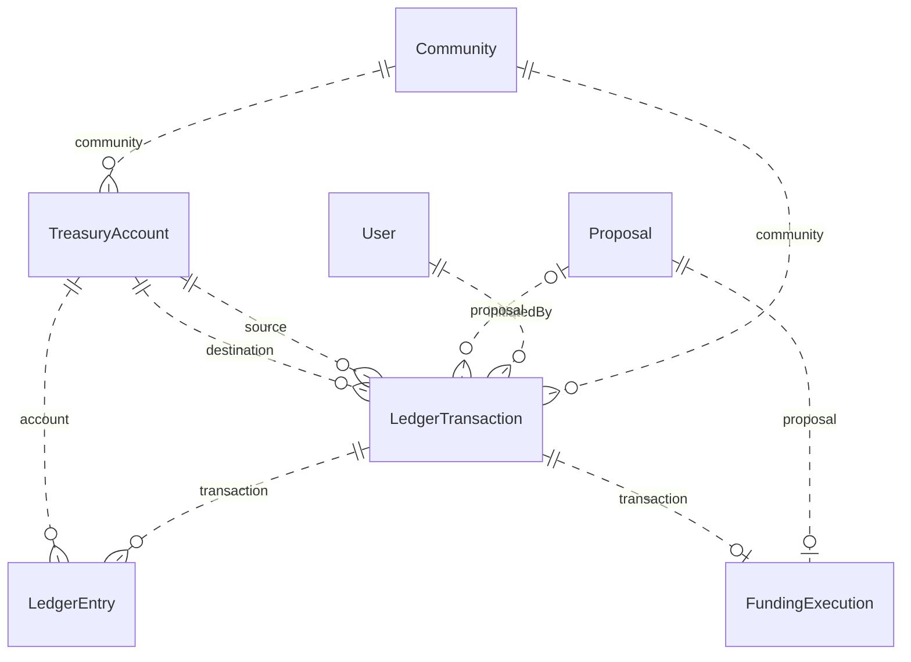
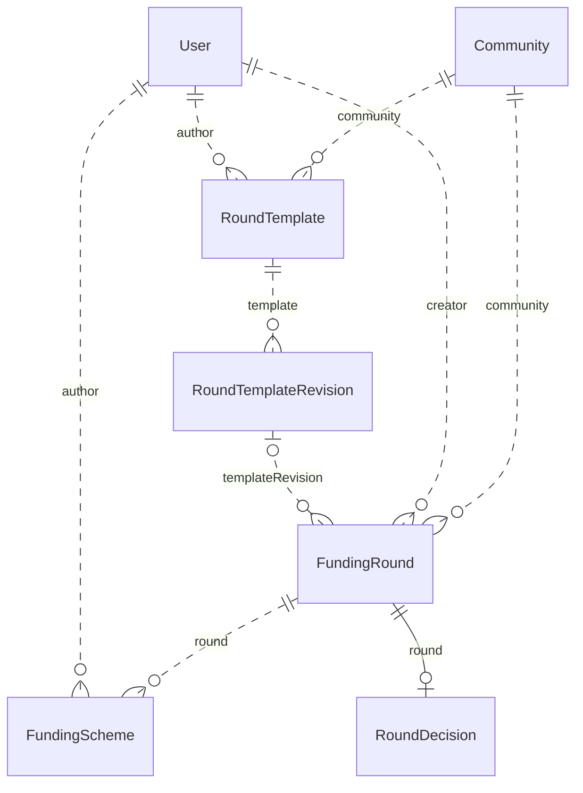
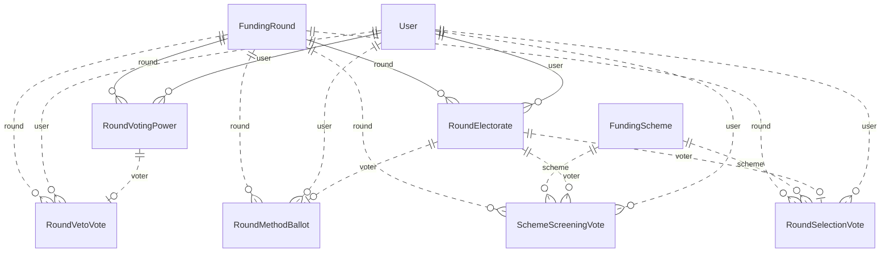
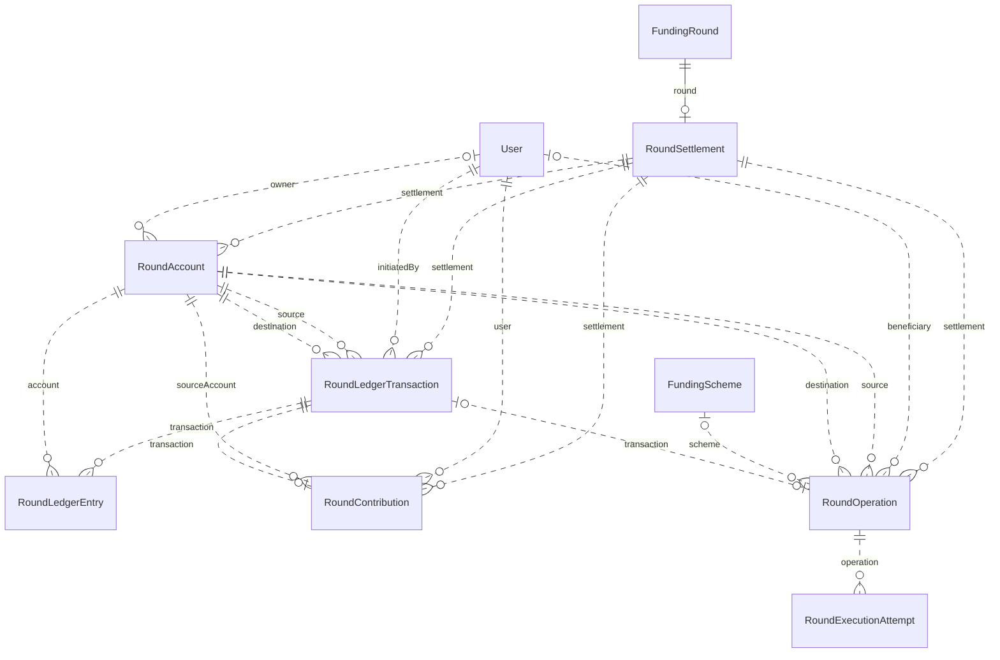
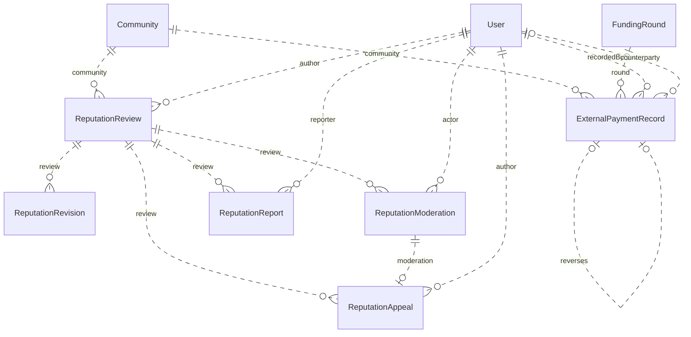
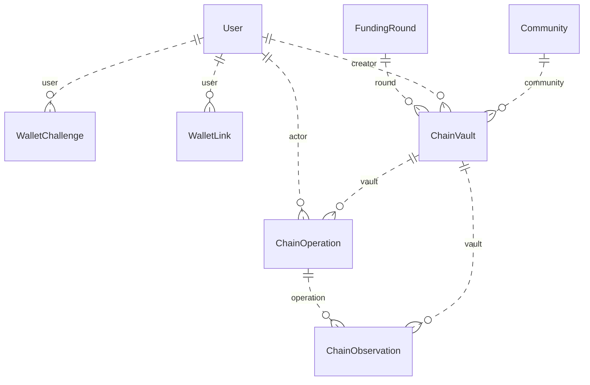

# PostgreSQL data model

[Documentation home](../README.md)

These ER diagrams group the physical relationships from the [Prisma schema](../../prisma/schema.prisma). Each edge names the relation field on its child record. A circle marks optional participation. A crow's foot marks a relationship that can have many children. Solid lines use a parent reference in the child's primary key. The tables list stored scalar fields. A question mark after a field means the column accepts null.

`Community` and `User` appear in several diagrams as shared references. Reputation target and context identifiers and activity target identifiers resolve according to their type fields. The application checks the target, context and community when it creates the record.

## Community and admissions

| Model | Purpose | Stored fields |
| --- | --- | --- |
| `Community` | Scoped workspace, administrator, public profile, currency and rules | `id, slug, name, description, purpose, imageUrl?, color, currency, adminId, minimumContribution, governanceProfile, createdAt` |
| `GovernancePolicy` | Admission route, submission settings, voting duration and quorum | `id, communityId, quorumBps, thresholdBps, admissionPolicy, allowMemberProposals, votingDays` |
| `CommunityMembership` | User, community, role, membership state and join history | `id, communityId, userId, role, status, suspensionReason?, joinedAt, declaredContribution?, declaredAt?` |
| `MembershipQuestion` | Ordered question for community applications | `id, communityId, prompt` |
| `MembershipApplication` | Applicant, pledge, introduction and disposition | `id, communityId, userId, introduction, proposedContribution, status, createdAt, decidedAt?` |
| `MembershipApplicationAnswer` | Answer keyed to its application and question | `id, applicationId, questionId, answer` |

## Proposal decisions

| Model | Purpose | Stored fields |
| --- | --- | --- |
| `Proposal` | Agenda, snapshot rules, dates, decision and optional application | `id, communityId, proposerId, title, description, type, status, amount, recipient?, supportingUrl?, targetUserId?, applicationId?, quorumBps, thresholdBps, opensAt, closesAt, finalizedAt?, cancellationReason?, governanceChange?, governanceProfile, successorId?, createdAt` |
| `EligibleVoter` | Frozen proposal and user pair | `proposalId, userId` |
| `Vote` | One immutable choice per eligible proposal voter | `id, proposalId, userId, choice, createdAt` |

## Accounts, activity and report preferences

| Model | Purpose | Stored fields |
| --- | --- | --- |
| `User` | Account identity and authentication metadata | `id, email, username, displayName, avatarUrl?, passwordHash, createdAt` |
| `Session` | Hashed session identity, expiry, revocation and password-confirmation time | `id, tokenHash, userId, createdAt, expiresAt, revokedAt?, reauthenticatedAt?` |
| `AuditEvent` | Actor, action and scoped target metadata | `id, communityId, actorId, action, entityId, details, createdAt` |
| `Notification` | Account activity and read marker | `id, userId, communityId, message, href, readAt?, createdAt` |
| `RateLimit` | Persistent time-window request counter | `key, count, expiresAt` |
| `DashboardPreference` | Per-user dashboard layout | `userId, widgets, updatedAt` |
| `SavedAnalyticsView` | Named report section and filters | `id, userId, name, filters, createdAt` |

## Community treasury

| Model | Purpose | Stored fields |
| --- | --- | --- |
| `TreasuryAccount` | Community account keyed by account kind | `id, communityId, kind, balance` |
| `LedgerTransaction` | Simulated transfer intent and replay identity | `id, communityId, initiatedById, proposalId?, amount, currency, type, status, idempotencyKey, simulated, network, sourceAccount, destinationAccount, externalReference?, confirmedAt?, createdAt` |
| `LedgerEntry` | Signed account posting for a ledger transaction | `id, transactionId, accountId, amount` |
| `FundingExecution` | One execution receipt per approved funding proposal | `id, proposalId, transactionId, status, network, accountId?, transactionHash?, confirmedAt?` |

## Round setup and publication

| Model | Purpose | Stored fields |
| --- | --- | --- |
| `RoundTemplate` | Named community rules template and archive state | `id, communityId, authorId, name, description, archivedAt?, createdAt` |
| `RoundTemplateRevision` | Numbered immutable rules snapshot | `id, templateId, number, rules, createdAt` |
| `FundingRound` | Versioned agenda, stage status, deadlines and rule provenance | `id, communityId, creatorId, title, description, proposalPolicy, quorumBps, status, submissionsCloseAt, screeningOpensAt?, screeningClosesAt?, selectionOpensAt?, selectionClosesAt?, decidedAt?, outcome?, winnerSchemeId?, createdAt, rulesVersion, templateRevisionId?` |
| `FundingScheme` | Submitted candidate, request, recipient and screening status | `id, roundId, authorId, title, description, amount, recipient, supportingUrl?, status, category, createdAt` |
| `RoundDecision` | Published result, allocation and veto state | `roundId, publishedAt, allocation, result, vetoClosesAt?, vetoFinalizedAt?, rejected, totalVetoPower` |

## Round electorates and ballots

| Model | Purpose | Stored fields |
| --- | --- | --- |
| `RoundVotingPower` | Versioned frozen equal eligibility and paid power | `roundId, userId, eligible, paidPower, frozenAt?, createdAt` |
| `RoundVetoVote` | One rejection-window ballot per frozen voter | `id, roundId, userId, choice, createdAt` |
| `RoundElectorate` | Frozen round and voter key used by election ballot rows | `roundId, userId` |
| `RoundMethodBallot` | Method-specific complete selection payload | `id, roundId, userId, method, ballot, createdAt` |
| `SchemeScreeningVote` | One screening choice per scheme and voter | `id, roundId, schemeId, userId, choice, createdAt` |
| `RoundSelectionVote` | Single-choice selection ballot | `id, roundId, schemeId, userId, createdAt` |

## Round accounts and operations

| Model | Purpose | Stored fields |
| --- | --- | --- |
| `RoundSettlement` | Round funding rules, asset and principal totals | `roundId, rulesVersion, assetId, currency, decimals, network, status, fundingTarget, minimumContribution, maximumContribution, collectionClosesAt, expiresAt, rulesSnapshot, contributionSnapshot?, frozenAt?, received, paid, refunded, allocationSnapshot?, preparedAt?, settledAt?, reason?, createdAt, updatedAt` |
| `RoundAccount` | Round ledger account and optional owner | `id, roundId, key, ownerId?, balance` |
| `RoundLedgerTransaction` | Confirmed round ledger movement and operation key | `id, roundId, operationKey, kind, amount, assetId, initiatedById, sourceAccountId, destinationAccountId, createdAt` |
| `RoundLedgerEntry` | Signed round account posting | `id, transactionId, accountId, amount` |
| `RoundContribution` | Contribution receipt tied to a source and posting | `id, roundId, userId, sourceAccountId, transactionId, amount, createdAt` |
| `RoundOperation` | Immutable settlement intent, beneficiary and processing state | `id, roundId, operationKey, kind, amount, beneficiaryId?, sourceAccountId, destinationAccountId, recipient, schemeId?, status, attempts, lastError?, transactionId?, createdAt, updatedAt, completedAt?` |
| `RoundExecutionAttempt` | Numbered attempt history per operation | `id, operationId, attempt, status, error?, createdAt` |

## Reputation and external attestations

| Model | Purpose | Stored fields |
| --- | --- | --- |
| `ReputationReview` | Author, target, dimension and qualifying context | `id, communityId, authorId, targetType, targetId, dimension, contextType, contextId, createdAt` |
| `ReputationRevision` | Numbered rating and written review revision | `id, reviewId, revision, score, text, createdAt` |
| `ReputationModeration` | Ordered visibility event with moderator and reason | `id, reviewId, actorId, sequence, action, reason, createdAt` |
| `ReputationReport` | Private member report for a review | `id, reviewId, reporterId, reason, createdAt` |
| `ReputationAppeal` | Author's appeal tied to a moderation event | `id, reviewId, moderationId, authorId, statement, createdAt` |
| `ExternalPaymentRecord` | Scoped attestation, external reference and optional source reversal | `id, communityId, roundId?, recordedById, counterpartyId?, kind, amount, currency, reference, note, evidenceUrl?, occurredAt, createdAt, reversesId?` |

## NEAR testnet custody and wallets

| Model | Purpose | Stored fields |
| --- | --- | --- |
| `WalletChallenge` | Historical account-ownership challenge | `id, userId, sessionHash, accountId, network, origin, nonce, message, expiresAt, consumedAt?, createdAt` |
| `WalletLink` | Historical network account association | `id, userId, network, accountId, publicKey, verifiedAt, revokedAt?` |
| `ChainVault` | Historical round-scoped custody design record | `id, communityId, creatorId, roundId, network, provider, assetId, decimals, contractId, title, rulesVersion, rulesSnapshot, collectionClosesAt, expiresAt, vetoEnabled, allocationHash?, plan?, publishedAt?, createdAt` |
| `ChainOperation` | Historical chain operation intent and status | `id, vaultId, actorId, operationKey, kind, amount, recipient, method, args, attachedDeposit, expectedSigner, status, transactionHash?, submittedAt?, confirmedAt?, createdAt` |
| `ChainObservation` | Historical provider observation linked to an operation | `id, vaultId, operationId, rpcUrl, transactionHash, finality, status, receiptIds, evidence, observedAt` |

## Persistence rules

- Proposal ballots identify the frozen eligible voter with the composite proposal and user key. Round ballots and veto votes link to their applicable electorate or voting-power snapshot.
- The ledgers store signed postings and exact integer amounts. A funded-round contribution, operation and transaction have separate roles in tracking intent, posting and replay.
- The external register stores original and reversal attestations. Its records link to applicable community, round and counterparty identities.
- Template revisions, review revisions and moderation sequences preserve prior records. See the [migrations](../../prisma/migrations) for database-enforced guards and the [architecture](architecture.md) for the service rules that use them.
