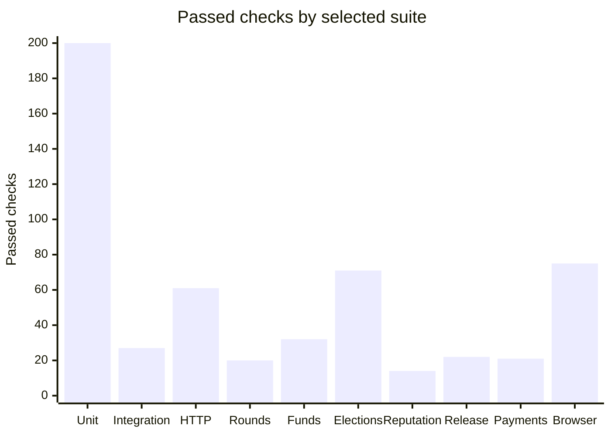
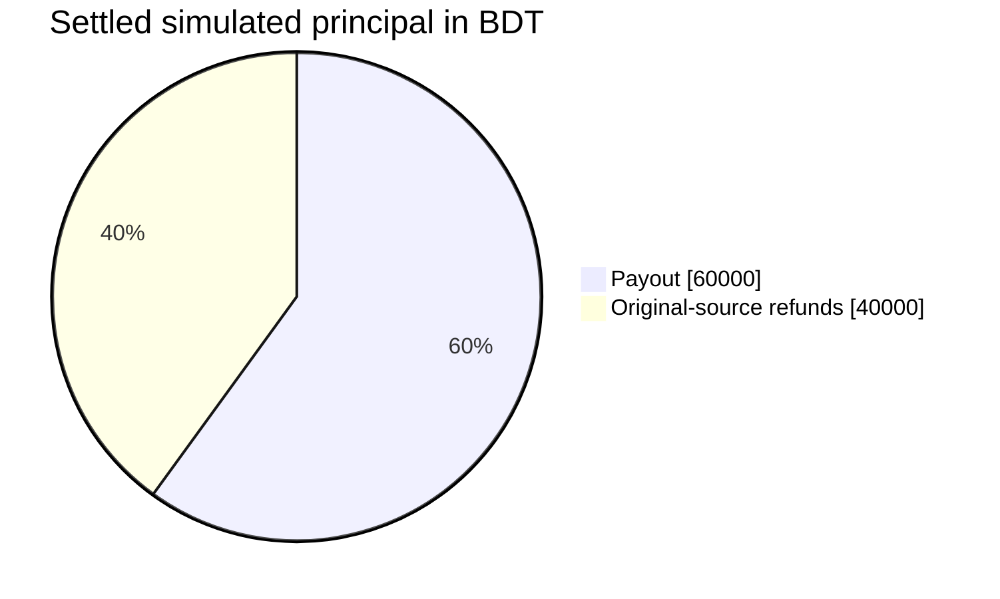

# Verification

[Documentation home](../README.md) · [Passed cases and receipt index](test-cases.md)

The 11 November 2026 verification snapshot records **21 of 21 required checks passed**. Each receipt records an exit code of zero and the same source fingerprint before and after its command. The local receipt index and the dated review identify the exact artifacts.

| Check | Reproduce from the repository root | Recorded outcome |
| --- | --- | --- |
| Workflow tests | `npm run test:progress` | 14 tests covering delivery state and evidence |
| Unit | `npm test` | 200 tests across 16 files |
| Type check | `npm run typecheck` | TypeScript check completed |
| Lint | `npm run lint` | ESLint check completed |
| Build | `npm run build` | Prisma client, TypeScript validation and standalone package built |
| PostgreSQL integration | `npm run test:integration` | 27 integrity and authorization checks |
| HTTP end-to-end | `npm run test:e2e` | 61 checks through the registration, admission, voting and execution flow |
| Application security | `npm run test:security` | 12 security groups |
| Funding rounds | `npm run test:rounds` | 20 checks across services, database, HTTP and browser |
| Funded rounds | `npm run test:funds` | 32 governance, ledger, HTTP, browser and recovery checks |
| Elections | `npm run test:elections` | 71 V3/V4 election, allocation, veto and recovery checks |
| Reputation | `npm run test:reputation` | 14 checks, including a browser flow with 4 accessibility scans |
| Release insights and templates | `npm run test:release` | 22 checks on rules, reporting, exports, UI and maintenance |
| External payment records | `npm run test:payments` | 21 checks on attestation, correction, access, HTTP and browser |
| Backup and restore | `npm run test:recovery` | Isolated PostgreSQL restore matched 50 tables and 5 accounting invariants |
| Hundred-member demonstration | `npm run demo:large` | 100 fictional members, 3 schemes and a reconciled simulated pool |
| Dependency audit | `npm run audit:dependencies` | Zero npm advisory matches in the recorded audit |
| Secret scan | `node scripts/security-scan.mjs` | Zero configured secret matches in scanned artifacts |
| Browser | `npm run test:browser` | 75 browser layout and interaction checks |
| Accessibility | `npm run test:accessibility` | 30 route and state scans with an empty violations list in each recorded result |
| Operations security | `npm run test:ops-security` | 9 runtime packaging and operator isolation tests |

## Coverage chart

The bars show the reported case counts for selected suites. Each runner defines its own check units.



## Verified package and recovery exercises

- **Native runtime and copied artifact.** The saved runs verified readiness, sign-in, three public and three authenticated routes, and dependency resolution from the copied standalone package.
- **Compose runtime.** The recorded run checked HTTP and operations against the composed stack. The same-version upgrade rehearsal preserved committed fixture data. Restore verified 50 tables, five financial invariants and consistent database collation.
- **Reputation browser replay.** The normal and traced runs each verified 14 cases. Each exercised review creation, editing, reporting, hiding, appeal and restoration in the browser.
- **Database recovery.** The snapshot comparison checked balanced community and round postings, both sets of account totals and conservation of round principal.

## Historical passes by delivery stage

Each linked record contains the full check list for its own source snapshot.

| Stage | Recorded passes | Evidence |
| --- | --- | --- |
| Part 1 | 31 unit tests, 27 PostgreSQL checks, 61 HTTP checks, 75 browser checks, 20 round scenarios and 14 round accessibility scans. Typecheck, lint and production build completed. | [Delivery verification](../archive/baseline-verification.md) · [Part 1](../parts/part-01.md#historical-verification-evidence) |
| Workflow planning | Delivery plan and workflow tooling verification | [Planning verification](../archive/planning-verification.md) |
| Part 2 | 47 unit tests, 13 workflow tests and the funded-round and governance suite with 32 checks and 8 accessibility scans | [Part 2 receipts](../parts/part-02.md#verification-evidence) |
| Part 3 | 57 unit tests, 13 workflow tests and 23 election and veto checks with 4 accessibility scans | [Part 3 receipts](../parts/part-03.md#verification-evidence) |
| Part 4 | 114 unit tests, 14 workflow tests, 69 election checks and 14 reputation checks | [Part 4 receipts](../parts/part-04.md#verification-evidence) |
| Part 5 | All 20 release receipts passed. Native packaging and Compose exercises verified startup, browser behavior and restoration. | [Part 5 receipts](../parts/part-05.md#verification-evidence) · [Container evidence](../security/container-audit.md) |
| Post-release verification | Standalone regression, packaging and database checks with dated evidence | [10 November](../security/post-release-audit-20261110.md) · [11 November](../security/post-release-audit-20261111.md) |

## Simulated BDT demonstration

The isolated fixture recorded 100,000 BDT of simulated principal. Settlement paid 60,000 BDT and returned 40,000 BDT to the original sources, with zero held or reserved after settlement.



The exercise also checked ballot visibility and a separate fictional external-payment register. See the [scenario walkthrough](../guides/hundred-member-demo.md).

## Reproduce checks

Use the repo's supported Node.js version, installed dependencies, generated Prisma Client and a reachable PostgreSQL test server. Build before suites that exercise HTTP or the browser. Run database-backed suites sequentially because the HTTP runner shares port 3001. It creates distinct disposable databases. The standalone browser and accessibility checks use the configured seeded app at `APP_ORIGIN`. See [getting started](../guides/getting-started.md) and the [test runner](../../scripts/test-db.mjs).

For the project-local Chromium used in these checks, run the following from the repository root. Browser QA writes screenshots under the ignored `test-results` directory.

```powershell
$env:PLAYWRIGHT_BROWSERS_PATH = Join-Path (Get-Location) '.local/browsers'
npx playwright install chromium --only-shell
```
